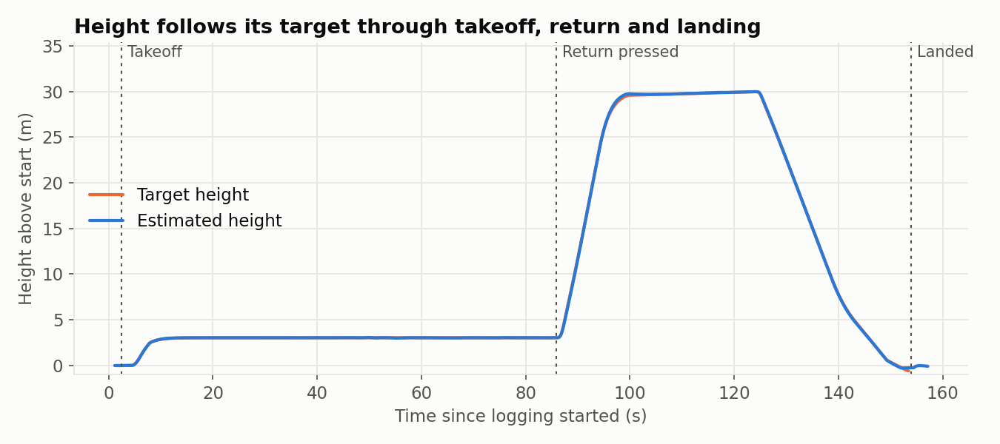
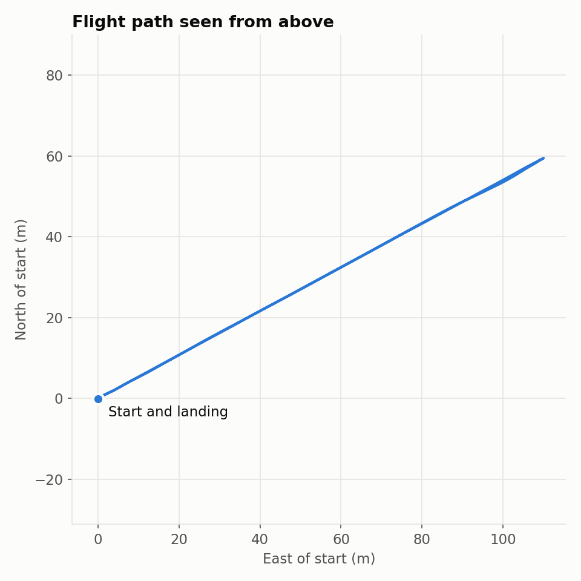
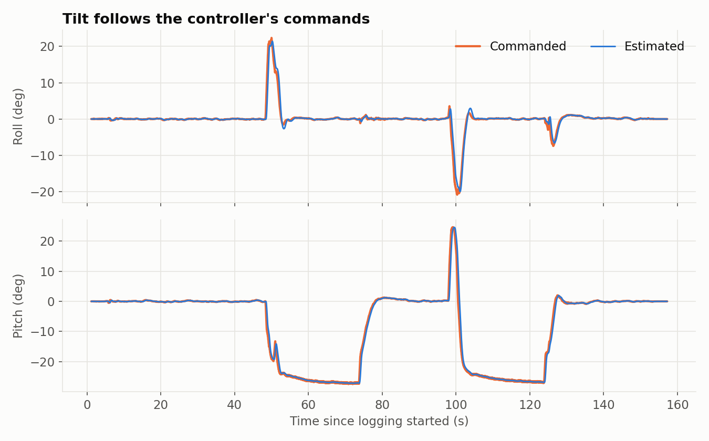
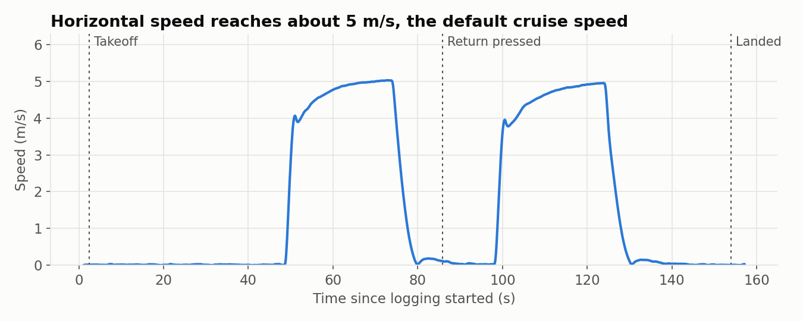
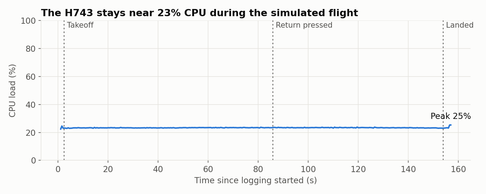

# SkySakura H743 V1.5: PX4 Port Study Notes

These notes record what was done to bring up this board on PX4, what was learned, and what is still untested.

> **Not flight ready.** This port has only been bench tested and flown in simulation. Keep the props off.

**Animated guide:** [SkySakura Porting Field Guide](https://claude.ai/artifact/SxNEgoqiHQVT9qZNXw6VFG) (private until shared). It was written before the SD card and tilt results below, so where they differ, trust these notes.

## Current status

| Item | Status | Evidence or next step |
| --- | --- | --- |
| Bootloader, firmware, USB updates | Working | Updates complete and verify over USB |
| All five sensors | Working | Zero bus errors across repeated reboots |
| SD card, saved settings, flight logs | Working | Setting survived a reboot, 9 MB log recorded |
| Accelerometer calibration | Working | Survived a reboot |
| IMU rotation (`-R 12`) | Passed | Tilt test, below |
| ICP-201xx barometer retry | Working so far | First start sometimes fails, retry succeeded each time logged |
| SIH simulated flight | Passed | Plots below |
| Compass rotation (`-R 2`) | **Not finished** | Z sign looks right, north/south test still to do |
| Buzzer, LEDs | **Not tested** | |
| RC input | **Not tested** | Default assumes ELRS/CRSF on UART4 |
| GPS, UARTs, CAN | **Not tested** | Needs hardware |
| Battery voltage and current | **Not tested** | Compare against a multimeter |
| Motor outputs and order | **Not tested** | Props off. DShot isn't available on outputs 7-8 |
| Compass calibration, level horizon | **Not done** | Do these once installed in the frame |
| Real flight | **Not done** | |

## Mounting

Mount the board with the **logo and `>>` arrows facing up and pointing forward**. The ST chip and IMUs face down.

The silkscreen and the ArduPilot image can make the ST side look like the top. It isn't. This caught me out during the tilt test.

## SIH flight results

SIH (Simulation In Hardware) runs PX4 and a physics model on the real FC. Motors and sensors are simulated, so this tests the chip, firmware and logging. **It says nothing about the real sensors, wiring or motors.**

Log: [Flight Review](https://logs.px4.io/plot_app?log=ff4d660c-141b-46a0-b911-c7ec02a74dfc). Anyone with the link can open it.

| Measure | Result |
| --- | --- |
| Logging duration | 157 s, about 152 s in the air |
| Logged errors, log dropouts | 0, 0 |
| CPU while flying | 23% average, 25% peak |
| RAM | 36% peak |
| Height error | 0.03 m average, 0.23 m worst |
| Horizontal error | About 0.2 m average, 1.4 m worst |
| Landing offset | 5 cm from takeoff |

Return first climbs to 30 m, flies home, then descends.

The path out and back overlap because Return flies straight home.

If the lines separated on a real flight, that would point to tuning or vibration problems.

**One warning to know about:** `sih low on stack! (184 bytes left)`. It stayed steady and only affects the simulator.

### Run SIH again

SIH is only on this branch. To use it:

1. Build and flash this branch.
2. Copy your settings: `cp /fs/microsd/params /fs/microsd/params_before_sih`
3. Run `param reset_all`, `param set SYS_AUTOSTART 1100`, `param save`, `reboot`.

To go back, run `param reset_all`, `param load /fs/microsd/params_before_sih`, `param save`, `reboot`.

**Never fly with `SYS_HITL` set to anything but 0.** The board would ignore its real sensors.

## What we learned

### Firmware layers

- **DFU code** is ST's factory loader in read-only memory. Hold the boot button at power-on to use it. It can't be erased.
- **The bootloader** is in flash sector 0. It decides what to run and installs firmware over USB.
- **Firmware** is NuttX and PX4 built together, starting at `0x08020000`.
- **Parameters** are settings and calibration, stored on the SD card here.

Each layer can repair the one above: DFU repairs the bootloader, and the bootloader repairs the firmware.

### How a port works

A port mostly describes the circuit board to PX4. The flight code doesn't change.

| File | Question it answers |
| --- | --- |
| `firmware.prototype` | Board name and ID (2714) |
| `default.px4board` | Which features are built, which port does what |
| `nuttx-config/include/board.h` | Clock and pin settings |
| `nuttx-config/nsh/defconfig` | Which NuttX parts are on |
| `src/board_config.h` | LEDs, buzzer, VBUS, battery sensing, timekeeper |
| `src/spi.cpp`, `src/i2c.cpp` | Which chip is on which bus |
| `src/timer_config.cpp` | Which timer drives which output |
| `init/rc.board_sensors` | Which drivers start, and how each is rotated |

Each `CONFIG_...` line in `default.px4board` is defined in a `Kconfig` file named after its path. For example, `CONFIG_DRIVERS_ADC_BOARD_ADC` is in `src/drivers/adc/board_adc/Kconfig`. See the [Kconfig guide](https://docs.px4.io/main/en/hardware/porting_guide_config.html).

### Traps from the template board

- `HRT_TIMER 2 /* use timer8 */`: the comment is wrong, and the code really uses timer 2. This board needs timer 2 for motors, so the timekeeper moved to timer 8. **Read the code, not just the comment.**
- `BOARD_PARAM_FILE` was missing, so settings tried to save to `/fs/mtd_params`, which doesn't exist here. Calibration would have been lost at every reboot. A similar board (`micoair/h743-v2`) showed the fix.
- Matek's board IDs disagree between its two files (139 and 1013). Here they both say 2714.
- ArduPilot enables pull-ups on I2C1, and that one word is easy to miss.

### Checking your work

- **Compiling proves very little.** Each check should be able to fail.
- **Write the expected result first.** The tilt table was written before seeing the data.
- **Ask the board.** Live readings beat documentation. ArduPilot's README and code disagreed on battery pins, and the board settled it.
- **Fingerprints are useful.** The gyro's fixed offset matched between ArduPilot and PX4, on every axis and sign.

### Tilt test result

The reading is what an accelerometer feels when still: the axis pointing up reads about +9.8.

| Position | X | Y | Z | Result |
| --- | --- | --- | --- | --- |
| Logo up | -0.34 | 0.13 | -9.78 | As expected |
| ST chip up | -0.12 | 0.41 | +9.78 | As expected |
| Arrow-tip edge up | +9.78 | 0.20 | -0.64 | As expected |

Up/down and front together fix left and right, since the axes are always at right angles.

### Mistakes worth remembering

| What happened | Wrong first idea | Real cause | Lesson |
| --- | --- | --- | --- |
| VS Code showed 10k changes | Too many files | Its status froze mid-clone | Read the tool's log |
| QGC flickered between Armed and Flying | No airframe set | Simulators were also sending to UDP 14550 | Odd values (GPS on a bare board) are clues |
| ICP-201xx didn't start | 100 kHz broken | First probe sometimes fails | Reproduce before fixing |
| Z read +9.8 on a flat board | Wrong rotation | The ST side is the bottom | Check assumptions about the test too |
| PX4 wouldn't fit the old bootloader | It should allow 1,920 KB | It only allowed 1,664 KB | Ask the hardware first |
| Compass stopped working | Sensor failure | `i2cdetect -b 1` wedged the bus | Debug tools can cause faults. Avoid this command here |

### Simulation types

| | Where PX4 runs | Where physics runs | Real sensors used? |
| --- | --- | --- | --- |
| SITL | Computer | Computer | No |
| HITL | FC | Computer (Gazebo Classic) | No |
| SIH | FC | FC | No |

Using simulators with QGroundControl: make sure only one vehicle is connected. **Turn off UDP in AutoConnect before plugging in a real FC.**

### Securing firmware

Only signed firmware can run if you enable PX4's [Secure Boot](https://github.com/PX4/PX4-Autopilot/blob/main/docs/en/advanced_config/bootloader_secure_boot.md), but it only guards the normal USB update path. DFU and the debug pads skip it. Closing those takes RDP Level 2, which is permanent and also removes your own recovery route. Test on a spare board first.

## Useful commands

Run these in QGroundControl's **Analyze Tools > MAVLink Console**.

| Command | Tells you |
| --- | --- |
| `ver all` | Board and firmware |
| `dmesg` | Boot log, your first stop |
| `icm42688p status` | Whether a driver is running, plus error counts |
| `listener sensor_accel` | Live data from a topic |
| `uorb top` | How fast each topic updates |
| `top` | CPU use per task |
| `commander check` | Why PX4 will or won't arm |
| `param status` | Where settings are stored |

**Avoid `i2cdetect -b 1`** on this board. It locks up the internal bus until you reboot.

## Sources

- [PX4 Porting Guide](https://docs.px4.io/main/en/hardware/porting_guide.html) and [NuttX Porting Guide](https://docs.px4.io/main/en/hardware/porting_guide_nuttx.html)
- [ArduPilot hwdef for this board](https://github.com/ArduPilot/ardupilot/blob/master/libraries/AP_HAL_ChibiOS/hwdef/SkySakuraH743/hwdef.dat) and [Betaflight config](https://github.com/betaflight/config/blob/master/configs/SSAK/SAKURAH743/config.h)
- [PX4 SIH on hardware](https://github.com/PX4/PX4-Autopilot/blob/main/docs/en/sim_sih/hardware.md) and [Hardware Simulation](https://github.com/PX4/PX4-Autopilot/blob/main/docs/en/simulation/hardware.md)
- [PX4 bootloader source](https://github.com/PX4/PX4-Autopilot/tree/main/platforms/nuttx/src/bootloader)
